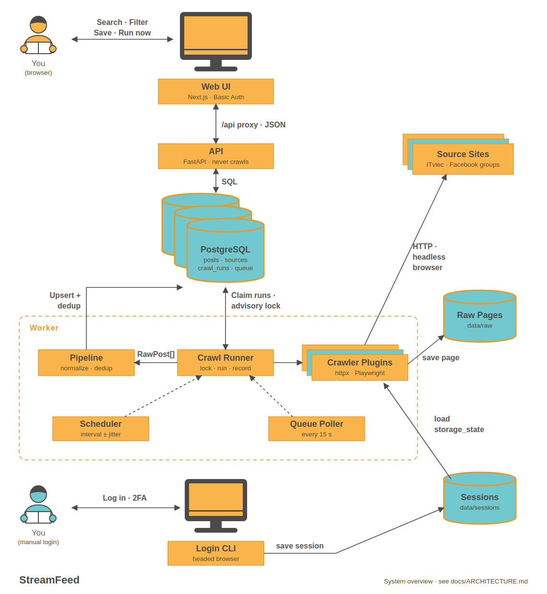
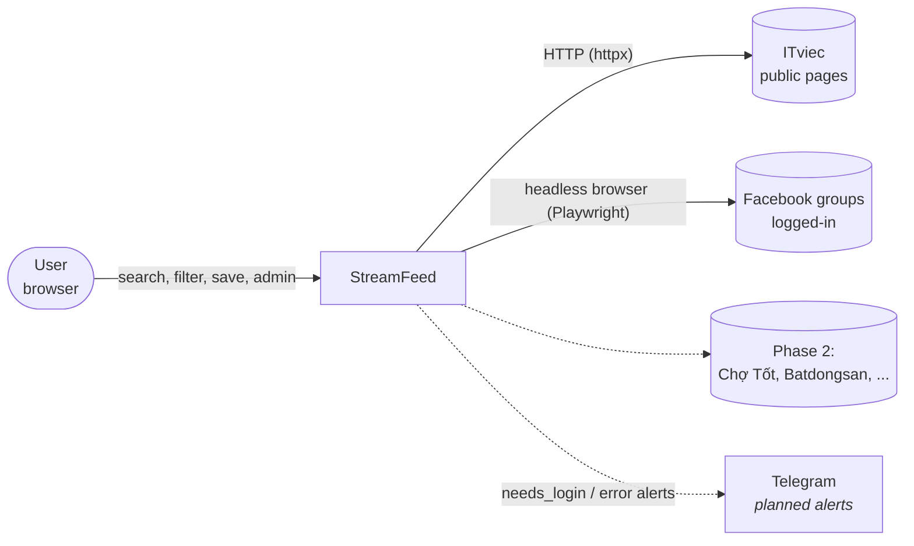
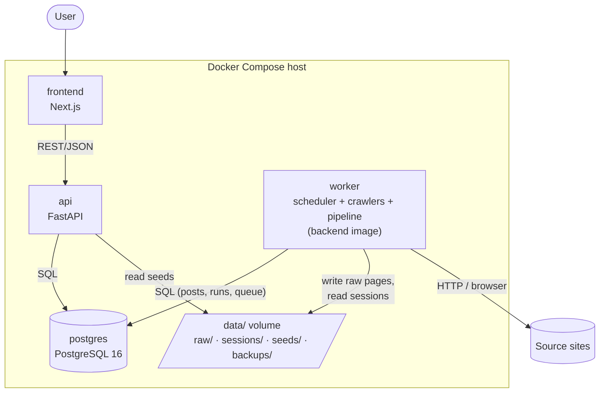
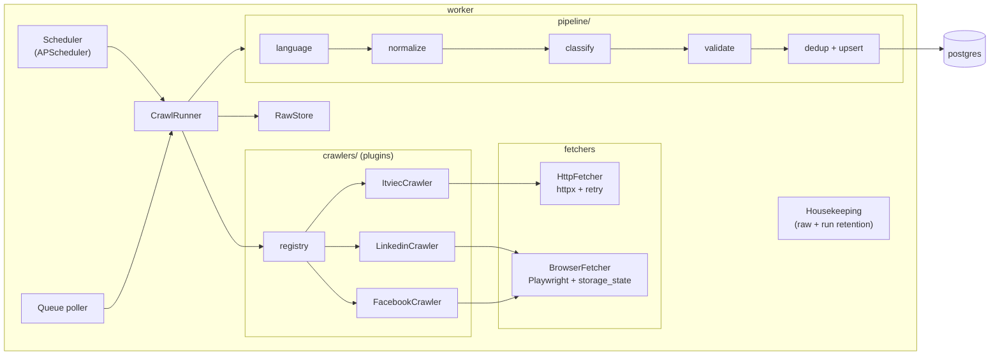
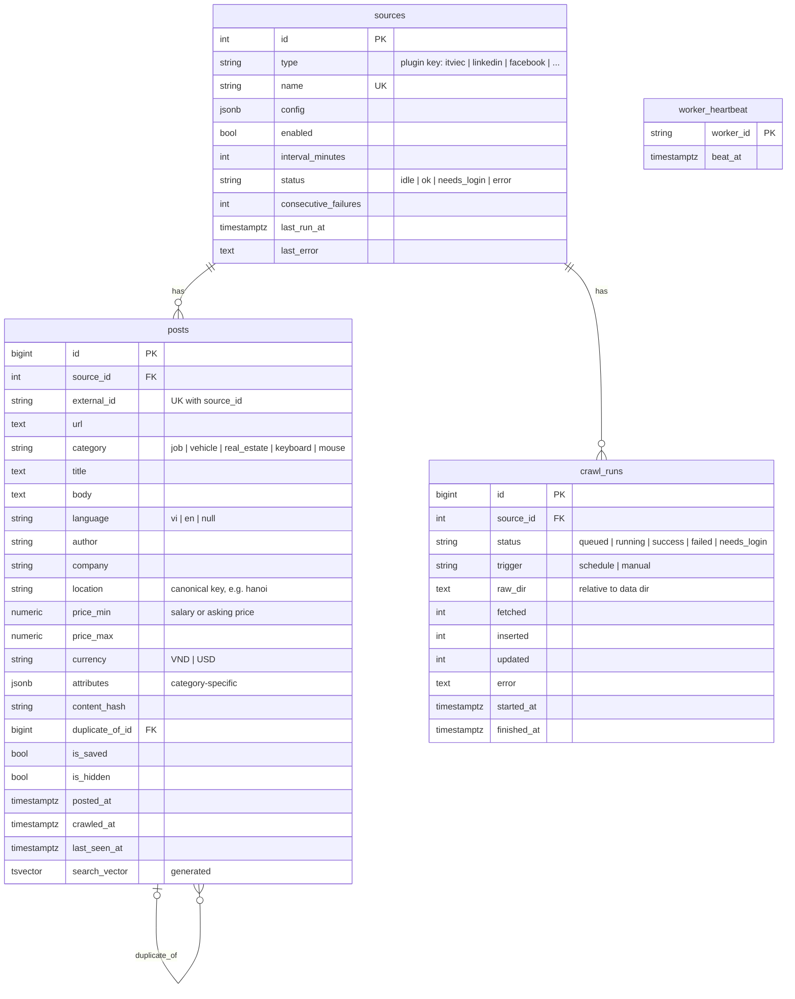
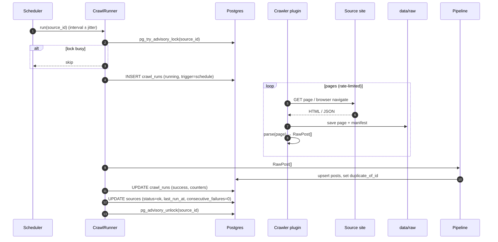
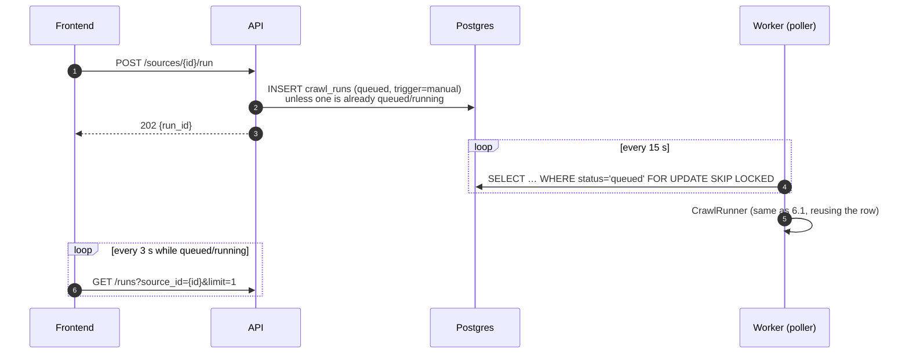
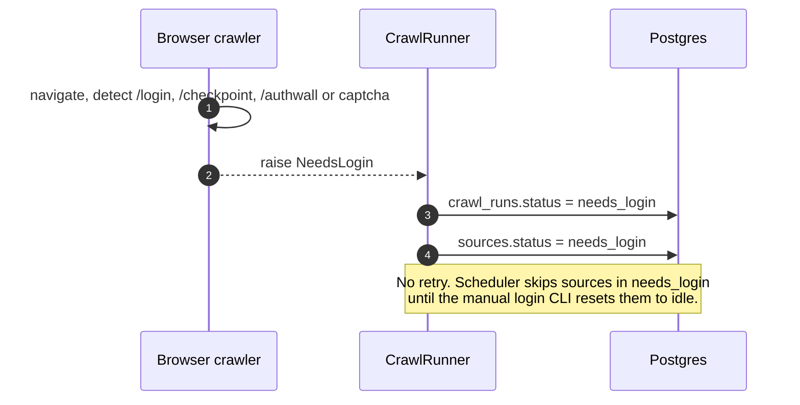
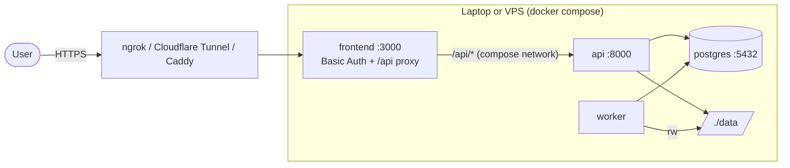

# StreamFeed — System Architecture

Status: **approved design**. Implemented so far: project scaffold, database schema, crawler framework, the bilingual pipeline and the ITviec crawler (steps 1–4). Items marked *(planned)* are not built yet.



---

## 1. Requirements

### Functional

| ID | Requirement |
|----|-------------|
| F1 | Crawl IT job posts from ITviec (every 1–3 hours) and Facebook groups (once a day). LinkedIn was dropped (see Source plugins). |
| F2 | Normalize posts written in Vietnamese or English: salary, location, level, skills, language. |
| F3 | Merge the same post seen on multiple sources ("Also on: LinkedIn"). |
| F4 | Accent-insensitive full-text search (`lap trinh` matches `lập trình`) plus filters: source, location, salary, level, language, posted time. |
| F5 | Save and hide posts. Hidden posts never reappear. |
| F6 | Admin page: source status, last run, enable/disable, interval, "Run now". |
| F7 | Phase 2: marketplace categories (vehicles, real estate, keyboards, mice) with category-specific filters. |

### Non-functional

| ID | Requirement |
|----|-------------|
| N1 | Single user, no accounts. |
| N2 | Low volume: ~200–1,000 new posts/day, DB < 1 GB/year. |
| N3 | Crawler robustness and **not getting accounts banned** matter more than freshness or speed. |
| N4 | Adding a source or a category must not require schema migrations. |
| N5 | Runs on a laptop or a small VPS (2 GB RAM) via Docker Compose. |
| N6 | All code and UI in English. Post content is stored unchanged in VI or EN. |

---

## 2. System context



---

## 3. Containers



| Container | Tech | Responsibility |
|-----------|------|----------------|
| `frontend` | Next.js (App Router), Tailwind, React Query | UI only; talks to `api` over REST. |
| `api` | FastAPI, SQLAlchemy | Search, CRUD, admin, enqueue manual runs. Runs migrations + seed on start. **Never crawls.** |
| `worker` | Same backend codebase, `python -m app.worker`, Dockerfile target `worker` (adds Google Chrome for BrowserFetcher). | Scheduling, crawling, pipeline, housekeeping. |
| `postgres` | PostgreSQL 16 + `unaccent`, `pg_trgm` | System of record **and** the job queue. |
| `data/` | Bind-mounted directory | Raw pages, login sessions, seed files, DB backups. |

### Key decisions

- **`api` and `worker` are separate processes.** A browser uses 300–500 MB RAM and crashes occasionally; the API must stay up regardless. Both share one codebase (`backend/app`), so models and the pipeline are not duplicated.
- **Postgres is the queue (no Redis/Celery).**
  - "Run now" inserts a `crawl_runs` row with `status='queued'`.
  - The worker claims it every 15 s with `SELECT … FOR UPDATE SKIP LOCKED`.
  - At this scale an extra broker would be pure operational cost.
- **One run per source at a time.** This is enforced with `pg_try_advisory_lock(source_id)`, which covers both scheduled and manual runs.
- **One browser at a time.** A process-wide semaphore keeps the RAM bound and makes traffic look human.

---

## 4. Components



**Worker loop as built** (`app/worker/__init__.py`): one crawl at a time in the main thread; each tick does at most one unit of work, then sleeps `WORKER_POLL_SECONDS` (15) only when idle.

1. **Orphan recovery:** a `running` run whose source advisory lock is free belongs to a dead worker and is marked `failed`. This replaces the time-based `recover_stale_runs` and also covers a worker killed mid-crawl by `docker compose stop`.
2. **Queue:** claim the oldest `queued` run with `FOR UPDATE SKIP LOCKED` and flip it to `running` in the same transaction, so two workers cannot take the same row. If the source is busy (lock held), the run goes back to `queued`.
3. **Schedule:** a source is due when `last_run_at + interval_minutes × backoff ± jitter` has passed (never-run sources are due at once). Backoff is `2^consecutive_failures`, capped at ×8. Jitter is drawn per source from `±CRAWL_JITTER_MINUTES` and redrawn after each run. Skipped: disabled sources, `needs_login`, no installed plugin, or an active run. The most overdue source runs first. Schedule changes made in the UI apply on the next tick; there are no per-source scheduler jobs to resync.
4. **Background thread (APScheduler):** heartbeat every 30 s (upsert `worker_heartbeat`), housekeeping every 24 h (delete `data/raw/<type>/<date>/` older than `RAW_RETENTION_DAYS` = 30, and finished `crawl_runs` older than `RUN_RETENTION_DAYS` = 90).
5. **Shutdown:** SIGTERM/SIGINT stop the loop after the current crawl; compose gives it `stop_grace_period: 2m`.

### Crawler contract

```python
class BaseCrawler(ABC):
    type: ClassVar[str]                 # "itviec", matches sources.type
    category: ClassVar[str] = "job"
    default_max_posts: ClassVar[int] = 200

    def create_fetcher(self) -> Fetcher: ...  # default HttpFetcher; browser crawlers override

    @abstractmethod
    def fetch(self, ctx: CrawlContext) -> Iterator[RawPage]: ...
    #   ctx = source snapshot + config, run id, fetcher, max_posts;
    #   yields pages as they are fetched and checks ctx.should_stop between pages

    @abstractmethod
    def parse(self, page: RawPage) -> list[RawPost]: ...
    #   pure function of the page content -> enables re-parse from disk and fixture tests
```

- `RawPage` holds `url`, `fetched_at`, `content_type` and `body`.
- `RawPost` holds the source-level fields: `external_id`, `url`, `title`, `body`, `company`, `author`, `location_raw`, `salary_raw` (+ `salary_currency_hint`), `work_mode_raw`, structured skill `tags`, `posted_at`, and an `extra` dict that is copied into `attributes`.
- `parse` must stay pure, with no network or DB access. That keeps crawlers testable with HTML fixtures and lets raw pages be re-parsed later.
- `registry.py` maps `type` to the crawler class. `sources.type` selects the plugin, and `sources.config` (JSONB) holds per-source parameters such as keywords, group URLs and `max_posts_per_run`.

### CrawlRunner (one run)

1. Try the advisory lock on `source_id`. If it is busy, skip the run (and drop the queued request).
2. Create or claim the `crawl_runs` row (`running`, `trigger`, `raw_dir`).
3. For each page from `crawler.fetch()`:
   - Write it to the RawStore.
   - Run `crawler.parse()`. A parse error on one page or post is logged and skipped.
4. Feed all `RawPost`s through the pipeline in one transaction per batch of 50.
5. Finish the run: set `status`, the counters and `finished_at`. Update `sources.status`, `last_run_at` and `consecutive_failures`.

### RawStore

- Layout: `data/raw/<source_type>/<YYYY-MM-DD>/<run_id>/<n>.html|json`, plus `manifest.json` with the url, fetched_at and content type of each file.
- `crawl_runs.raw_dir` points to the run's folder. `python -m app.crawlers reparse <run_id>` replays the run without touching the network.

### Source plugins

| Plugin | Status | How it works |
|--------|--------|--------------|
| `itviec` | built | Listing pages `/it-jobs[/<keyword>][/<location>]?page=N` (20 cards each) until `max_posts_per_run` slugs are collected, then one detail page per job. Cards give title, company, the precise "posted N minutes ago" time, work mode and skill tags. The detail page's JSON-LD `JobPosting` gives description, benefits, salary text, address and expiry. `external_id` is the job slug. Salaries are often hidden ("You'll love it"). |
| `linkedin` | dropped (2026-11-17) | A guest-search crawler was built and removed: LinkedIn answered 429 to every automated client tried (httpx, Playwright Chromium, Chrome stable in the container) while curl and an older local Chrome got 200. Not pursued further, since getting through would mean evading its bot detection. A browser extension that saves jobs the owner browses is the open alternative. |
| `facebook` | built, live since 2026-11-19 | Secondary account session (`data/sessions/facebook.json`, from the login CLI) loaded into BrowserFetcher (Google Chrome, headless). Once a day in `daily_window`, for each group: open `/groups/<id>/?sorting_setting=CHRONOLOGICAL`, wait for the feed, expand "See more", read each feed child (the post itself is not a `[role=article]`; its comments are, and are skipped), scroll 900–2,200 px with 3–8 s pauses until `max_posts_per_group` or `max_scrolls`; 20–60 s between groups. One JSON page per group (post text, author, links outside comments, post ids, and up to 10 of the comments already shown, which are not expanded further) is saved; no page HTML is kept, so `parse()` is pure and re-runnable. **Post identity:** Facebook hides the permalink (the timestamp link points at the group and its text is scrambled), so the post id is read from links already on the page (collected in the browser as `post_ids`): comment links `/posts/<id>/?comment_id=` and photo links `set=gm.<id>` (older runs: from the saved HTML); otherwise a hash of author + the first 120 characters. **Post time is not available** (revealed only on hover, which the crawler does not simulate); the feed falls back to the crawl time. Salary comes from the first line with a salary word and an amount with a unit (else a "negotiable" line). Login form, `/login`, `/checkpoint`, 2FA or a "temporarily blocked" page raise `NeedsLogin` immediately. The test fixture is synthetic on purpose: real group pages contain other members' names and posts. |

---

## 5. Data model



### Schema conventions

- **Generic posts.** Every category lives in `posts`, and category-specific fields go in `attributes`.
  - Each category's attributes are validated by a Pydantic schema in `app/schemas/attributes/<category>.py`.
  - Job (`app/schemas/attributes/job.py`): `levels[]`, `skills[]`, `locations[]`, `work_mode`, `salary_negotiable`, `salary_text`, `employment_type`, `expertise`, `experience_months`, `valid_through`.
  - Example for vehicle: `brand`, `model`, `year`, `mileage_km`.
- **Strings, not DB enums.**
  - `sources.type` and `posts.category` are unconstrained strings (N4).
  - Statuses use CHECK constraints generated from Python `StrEnum`s.
- **Search columns.** `search_vector` is generated from `f_unaccent(title)` (weight A), `company` (B) and `body` (C) with the `simple` config, and backed by a GIN index. There is also a trigram GIN index on `f_unaccent(title)`, plus GIN on `attributes` and a btree on `(category, posted_at DESC)`.
- **`f_unaccent(text)`.** This is an IMMUTABLE wrapper around `unaccent`, required for generated columns and indexes. Always use it; never call `unaccent()` directly.

### Migrations

- `ef6adc1dac6e` initial schema: tables, extensions, `f_unaccent`, search indexes.
- `b1295f6e9bcb` (step 3): adds `queued` status, `trigger`, `raw_dir`, `consecutive_failures`, `last_seen_at`, the `worker_heartbeat` table, and a partial index on queued runs.

---

## 6. Key flows

### 6.1 Scheduled crawl



### 6.2 Manual "Run now"



### 6.3 Login or checkpoint detected



Posts parsed earlier in the interrupted run are not ingested. Their pages are already in the RawStore, so `reparse <run_id>` can recover them after logging in.

### 6.4 Manual login (on the host machine)

1. Run `python -m app.crawlers.login facebook`. This opens a **headed** Chromium; you log in and pass 2FA yourself.
2. The CLI saves Playwright `storage_state` (cookies + localStorage) to `data/sessions/facebook.json` with mode `0600`.
3. The CLI resets the source to `status='idle'`.
4. The worker container loads the same JSON into a fresh browser context.

**Why `storage_state` instead of a persistent Chromium profile:** a profile directory is tied to the Chromium build and OS, so it does not move between the host (headed login) and the container (headless crawl). A JSON session does.

### 6.5 Search

1. `GET /posts?q=lap trinh&location=hanoi&sort=relevance`
2. `search_vector @@ plainto_tsquery('simple', f_unaccent(:q))`, plus filters on `category`, `source.type`, `location`, `attributes @> {...}`, salary and `posted_at`.
3. By default the feed excludes `is_hidden`, duplicates (`duplicate_of_id IS NOT NULL`) and stale posts.
4. Results are ordered by `ts_rank` or `posted_at DESC`, with keyset pagination.

### 6.6 Re-parse

`python -m app.crawlers reparse <run_id>` reads `raw_dir`, calls `parse` and then runs the pipeline. The upsert makes it idempotent. Use it after fixing a parser bug.

---

## 7. Pipeline

| Stage | Input → Output | Rules |
|-------|----------------|-------|
| **merge** | RawPosts → one per `external_id` | A source may emit the same post from several pages (ITviec: listing card + detail page). The first non-empty value of each field wins and later pages only fill gaps, so crawlers yield their most precise page first. |
| **language** | text → `vi` / `en` / null | lingua restricted to {Vietnamese, English}; null if the text is under 20 characters. |
| **normalize** | raw strings → typed fields | See below. |
| **classify** | post → `category` | Source default (job sources → `job`). Mixed Facebook groups: drop posts that are not hiring posts, using keywords such as `tuyển`, `tuyen dung`, `hiring`, `JD`, `we are looking`. |
| **validate** | `attributes` → validated dict | Pydantic schema per category; unknown keys are dropped, and invalid posts are logged and skipped. |
| **dedup + upsert** | post → DB row | See below. |

### Normalization (bilingual)

All matching runs on lower-cased, unaccented text. The alias dictionaries live in `app/pipeline/data/*.yaml`.

- **Salary:**
  - `15–25 triệu`, `15-25tr`, `15 - 25 million VND` → 15,000,000–25,000,000 VND
  - `up to $2,000`, `tới 2000 USD` → max = 2000 USD
  - `1.500–2.000 USD` → 1500–2000 USD (`.` is the Vietnamese thousands separator)
  - `Up To 35M Gross` → max = 35,000,000 VND. Values ≥ 100,000 are always VND, even when the source labels them USD (ITviec does).
  - `thỏa thuận`, `negotiable`, `cạnh tranh`, `competitive`, `You'll love it` → min/max null and `attributes.salary_negotiable = true`
  - The text as written is kept in `attributes.salary_text`.
  - The original currency is kept. Salary filters in USD convert VND at query time using the `USD_VND_RATE` setting.
- **Location:**
  - `Hà Nội | Hanoi | Ha Noi` → `hanoi`
  - `TP.HCM | Hồ Chí Minh | HCMC | Saigon | Thủ Đức` → `hcmc`
  - `Đà Nẵng | Da Nang` → `danang`
  - `remote | làm từ xa`, or work mode `remote` → `remote`
  - Every matched location goes into `attributes.locations`. The first one becomes `posts.location`.
- **Level** (matched in titles only; every level found is kept, e.g. `Middle/Senior` → `[mid, senior]`):
  - `intern | thực tập` → `intern`
  - `fresher` → `fresher`
  - `junior` → `junior`
  - `middle | mid` → `mid`
  - `senior | sr` → `senior`
  - `lead | trưởng nhóm | team lead` → `lead`
  - `manager | quản lý` → `manager`
- **Skills:**
  - Structured tags from the source (ITviec) are mapped through `skills.yaml` aliases, e.g. `C language` → `c`, `HTML5` → `html`, `Golang` → `go`. Unknown tags are kept as slugs.
  - Free text (Facebook) is matched against the dictionary with word boundaries. Ambiguous aliases (`go`, `c`, `ai`, `ba`, ...) are listed under `tag_only` and are not matched in free text.
- **Work mode:** `At office | tại văn phòng` → `onsite`; `Hybrid | linh hoạt` → `hybrid`; `Remote | làm từ xa` → `remote`.

### Dedup

1. **Within a source:** upsert on `(source_id, external_id)`.
   - A new post is inserted.
   - An existing post gets its content and `last_seen_at` refreshed. `is_saved` and `is_hidden` are kept.
   - `external_id` is the site's own ID, or `sha1(canonical_url)` when the site has none.
2. **Across sources:**
   - `content_hash = sha256(norm(title) + "|" + norm(company))`.
   - Facebook posts have no company, so they use `sha256(norm(body)[:300])`.
   - If another source holds a post with the same hash from the last 30 days, set `duplicate_of_id` to the oldest such post.
   - The API returns the canonical post with `also_on: ["linkedin", ...]`.

---

## 8. API

Base URL: `/`. JSON only. Errors use `{"detail": ...}`. Interactive docs: `/docs` (OpenAPI).
Code: `app/api/routes/*` (routers), `app/api/schemas.py` (models), `app/services/search.py` (feed query).

| Method | Path | Purpose |
|--------|------|---------|
| GET | `/health` | API liveness. |
| GET | `/health/worker` | 200 if the newest worker heartbeat is at most 2 min old, else 503 (`status`: `ok`, `stale`, `missing`). |
| GET | `/posts` | Feed and search (parameters below). |
| GET | `/posts/{id}` | Post detail with `body` and `duplicates` (the other posts of its duplicate group). |
| PATCH | `/posts/{id}` | `{is_saved?, is_hidden?}` |
| GET | `/sources` | Sources with status, plugin info (`plugin_available`, `category`, `min_interval_minutes`), `post_count` and `last_run`. |
| GET | `/sources/{id}` | One source, same shape. |
| PATCH | `/sources/{id}` | `{enabled?, interval_minutes?, config?}`; `config` replaces the whole object. `422` if the interval is below the plugin's `min_interval_minutes` (30 by default, 180 for login-based sources). |
| POST | `/sources/{id}/run` | Enqueue a manual run → `202 {run_id}`. `409` if a run is already queued or running, the source is `needs_login`, or no plugin is installed for its type. The source row is locked (`FOR UPDATE`) so double clicks queue one run. |
| GET | `/runs` | `?source_id=&status=&limit=` (max 100): recent crawl runs, newest first. |
| GET | `/runs/{id}` | One run; the UI polls it after "Run now". |
| GET | `/stats` | Default-feed counts: `total`, `new_24h` (by `crawled_at`), `saved`, per category, per source. |
| GET | `/meta/categories` | Categories (those with an attribute schema or with posts) and their **filter schema** with option counts. |

### `GET /posts` parameters

- **Search and filters:**
  - `q`: full-text, accent-insensitive (`plainto_tsquery('simple', f_unaccent(q))`)
  - `category` (default `job`)
  - `source_type` (repeatable)
  - `language`: `vi` or `en`
  - `salary_min_usd`: keeps posts whose upper price (`price_max`, else `price_min`) is at least this much; VND is converted with `USD_VND_RATE`. Posts without a number (negotiable) are excluded.
  - `since`: `24h`, `7d` or `30d`, on `coalesce(posted_at, crawled_at)`
  - `saved`
  - **Attribute filters:** every attribute schema field marked `json_schema_extra={"filter": "<Label>"}` is a parameter named after the field. Jobs: `levels`, `skills`, `locations`, `work_mode`, `expertise`. Repeat a parameter for several values; any value matches (`?levels=senior&levels=lead`). Filters on different parameters combine with AND. Matching uses JSONB containment (`attributes @> ...`), served by the GIN index.
  - **Visibility:** `include_hidden`, `include_duplicates`, `include_stale`. A post is stale when `last_seen_at` is older than `STALE_AFTER_DAYS` (30), or, for Facebook, when it was posted more than 30 days ago. `saved=true` ignores staleness, since saved posts are kept forever.
- **Sorting and paging:**
  - `sort`: `relevance` (the default when `q` is set; `ts_rank_cd`) or `newest`
  - `cursor`: opaque, URL-safe base64 of `{sort, key, id}`; keyset paging on `(key, id) DESC`. A cursor from another sort order, or a malformed one, returns `400`.
  - `limit`: maximum 50, default 20
- **Response:**

```json
{
  "items": [
    {
      "id": 123, "title": "...", "company": "...", "url": "...",
      "source": {"id": 1, "type": "itviec", "name": "ITviec - IT jobs"},
      "category": "job", "language": "vi", "location": "hanoi",
      "price_min": 2000, "price_max": 3000, "currency": "USD",
      "attributes": {"levels": ["senior"], "skills": ["python"]},
      "posted_at": "2026-11-16T08:00:00Z", "crawled_at": "2026-11-16T08:05:00Z",
      "is_saved": false, "is_hidden": false, "duplicate_of_id": null,
      "also_on": ["linkedin"], "snippet": "first 240 characters of the body…"
    }
  ],
  "next_cursor": "eyJ..."
}
```

`also_on` lists the other source types in the post's duplicate group (the canonical post plus every post whose `duplicate_of_id` points at it).

### `GET /meta/categories` response

```json
{
  "categories": [
    {
      "key": "job", "label": "Jobs", "price_label": "Salary", "post_count": 60,
      "filters": [
        {"key": "source_type", "label": "Source", "type": "multi_select",
         "options": [{"value": "itviec", "label": "ITviec", "count": 60}]},
        {"key": "language", "label": "Language", "type": "select", "options": [...]},
        {"key": "levels", "label": "Level", "type": "multi_select",
         "options": [{"value": "senior", "label": "Senior", "count": 17}, ...]},
        {"key": "locations", "label": "Location", "type": "multi_select",
         "options": [{"value": "hcmc", "label": "Ho Chi Minh City", "count": 33}, ...]}
      ]
    }
  ],
  "usd_vnd_rate": 26000
}
```

- Each filter `key` is a `GET /posts` parameter. Counts cover the default feed.
- Options of `Literal` fields come from the schema, in schema order, including zero counts. Free-valued fields (skills, locations, expertise) list the 100 most frequent values from the data.
- Labels: source types use the plugin's `label`, locations use `labels:` in `app/pipeline/data/locations.yaml`.

---

## 9. Frontend

- **Routes:**
  - `/`: feed with category tabs, search bar, filter sidebar and infinite scroll.
  - `/posts/[id]`: post detail with a link to the original.
  - `/admin/sources`: source table with status badges, last run, toggles and "Run now".
- **Filter state lives in the URL** (search params). Feeds can be bookmarked, and the back button works. React Query uses the search params as the query key.
- **Dynamic filters:** `/meta/categories` drives the tabs and the sidebar. A new category appears without frontend changes, except optional custom rendering.
- **Rendering:** the layout uses server components; feed, filters and admin are client components (React Query, `useInfiniteQuery`).
- **URL = API query:** the page's search params are passed to `GET /posts` unchanged (plus `limit` and `cursor`), so UI filter keys equal API parameter names. Changing a filter replaces the URL; it never pushes history entries for each keystroke (the search box is debounced by 300 ms).
- **Configuration:** the browser calls `/api/*` on its own origin; the Next.js server proxies it to `API_INTERNAL_URL` (build time). `NEXT_PUBLIC_API_URL` can point the client at another origin instead. `BASIC_AUTH_USER`/`BASIC_AUTH_PASSWORD` (runtime) turn on the login.
- **Display:** UI labels are in English and post content is shown unchanged (with its `lang` attribute). Relative times look like "2h ago", and salaries like "15–25M VND" or "$2,000–3,000".
- **Pay rail:** every feed row and the detail page draw the salary as a bar on one shared USD scale ($0 to 6k+, VND converted with `usd_vnd_rate` from `/meta/categories`). The rails line up in a column, so pay can be compared down the feed. Negotiable posts show a dashed, empty track.
- **Per-viewer state:** the time of the previous visit is kept in `localStorage` to mark posts crawled since then. Saved/hidden state is server-side (`PATCH /posts/{id}`), with optimistic cache updates and an undo toast for Hide.
- **Admin:** `/admin/sources` polls `/sources` and `/runs` every 3 s while a run is queued or running, and shows a banner when `/health/worker` is not `ok`.

---

## 10. Extensibility

**Add a source:**
1. Create `app/crawlers/<name>.py` subclassing `BaseCrawler` (`type`, `fetcher`, `fetch`, `parse`).
2. Register it in `app/crawlers/registry.py`.
3. Add an entry to `data/seeds/sources.yaml`.
4. Add HTML fixtures and parser tests in `backend/tests/`.
5. No migration is needed.

**Add a category:**
1. Add `app/schemas/attributes/<category>.py` (a Pydantic model; field metadata becomes the filter schema).
2. Add the value to `Category` in `app/models/post.py`.
3. Add normalizer dictionaries or classifier keywords if needed.
4. No migration and no frontend change are needed; the tab and filters come from `/meta/categories`.

---

## 11. Reliability and anti-blocking

| Concern | Policy |
|---------|--------|
| ITviec rate | 1 request every 2–4 s (random), realistic desktop User-Agent, up to 3 retries with exponential backoff on 5xx or timeout. |
| Daily sources (Facebook) | Once a day in a local window (`config.daily_window`, random minute per day, `app/scheduling.py`); a manual run counts as that day's run; failures skip 2/4/8 days. Throttling is never retried. |
| Login wall / checkpoint | Stop immediately, set `needs_login`, **never retry** (flow 6.3). |
| Consecutive failures | The effective interval is `interval × 2^failures`, capped at ×8. After 5 failures, `status=error`; the source keeps running at the capped interval. |
| Partial failures | One bad page or post is logged and skipped; the run still succeeds. |
| Selector drift | If pages were fetched but 0 posts were parsed, the run is `failed` with the error `"selector drift: 0 posts parsed from N pages"`. |
| Concurrency | Per-source advisory lock, and a single browser semaphore. |
| Worker crash | Rows left `running` for more than 1 h are marked `failed` when the worker starts. |

---

## 12. Deployment



- **Compose services:** `postgres`, `backend` (the API), `worker`, `frontend`.
  - `backend` runs `alembic upgrade head` and `app.seed` on start and has a `/health` healthcheck.
  - `worker` and `frontend` wait for `backend` to be healthy; the worker never migrates.
- **One public entry point.** The browser only talks to the frontend origin. `next.config.ts` rewrites `/api/*` to `API_INTERNAL_URL` (`http://backend:8000`, fixed at image build time), so the API needs no public port, no CORS, and the image does not depend on the public hostname.
- **Access control:** `frontend/src/middleware.ts` (Node.js runtime) enforces HTTP Basic Auth on every path, `/api/*` included, when `BASIC_AUTH_USER`/`BASIC_AUTH_PASSWORD` are set. There are no accounts, and the admin endpoints can change sources and trigger crawls, so a reachable instance must have them set. Credentials are compared in constant time.
- **Local development** (`docker-compose.yml` alone): Postgres (5433) and the API (8000) are published on `127.0.0.1` only; the frontend on 3000. Basic Auth is optional.
- **Server or public demo:** add `docker-compose.prod.yml`:
  - Postgres and the API publish no ports (`ports: !reset []`).
  - `BASIC_AUTH_USER`, `BASIC_AUTH_PASSWORD` and `POSTGRES_PASSWORD` are required (compose refuses to start without them).
  - Put HTTPS in front: Basic Auth over plain HTTP exposes the password. A tunnel (ngrok, Cloudflare Tunnel) needs no open inbound port; on a VPS, Caddy with automatic HTTPS works too.
  - `POSTGRES_PASSWORD` only takes effect when the volume is first created. To change it later, run `ALTER USER` inside Postgres as well.
- **Login sessions** (Facebook) are created on the host and reach the worker through the `./data` mount. The Playwright versions on the host and in the worker image must match.
- *(planned)* **Backups:** a daily `pg_dump` into `data/backups/` (gitignored), keeping 7 copies.

---

## 13. Security and privacy

- **Session files are account credentials.**
  - They live in `data/sessions/*.json`, which is gitignored, with mode `0600`.
  - The `api` container never needs them.
  - Cookies are never logged.
- **Use a secondary account** for Facebook.
- **No data leaves the system.**
  - Scraped content is only shown to the owner.
  - There is no public API and no re-publishing.
- **Network:**
  - Only the frontend is published in production; it proxies `/api/*` to the API over the compose network.
  - Every path, the API included, sits behind Basic Auth when deployed (section 12). CORS still allows only the frontend origin for direct API use in development.

---

## 14. Observability

- **Logs:** structured JSON lines with `source`, `run_id`, `event`, `duration_ms`. Logs never include cookies or full page bodies.
- **Crawl monitoring:** the `crawl_runs` table, surfaced on `/admin/sources`, is the primary tool.
- **Worker liveness:** the worker upserts `worker_heartbeat` every 30 s, and `/health/worker` exposes it.
- *(planned)* A Telegram alert fires when a source moves to `needs_login` or `error`.

---

## 15. Data lifecycle

| Data | Retention |
|------|-----------|
| `data/raw/` | 30 days; deleted by the daily housekeeping job. |
| Job posts | Hidden from the default feed when `last_seen_at` is more than 30 days old (Facebook: `posted_at` more than 30 days old). Never deleted automatically. |
| Saved posts | Kept forever. |
| `crawl_runs` | 90 days. |
| Backups | 7 daily dumps. |

---

## 16. Capacity estimates

| Item | Estimate |
|------|----------|
| New posts | ~1,000/day |
| Raw storage | ~5 KB/post → ~5 MB/day → ~150 MB with 30-day retention |
| Database | ~300 MB/year including indexes |
| Search latency | < 50 ms for < 1M rows with GIN indexes |
| Memory | Postgres ~200 MB, API ~100 MB, worker ~500 MB with the browser open, Next.js ~150 MB → fits in 2 GB |

---

## 17. Architecture decisions

| Decision | Rationale | Rejected alternative |
|----------|-----------|----------------------|
| Python + FastAPI backend | Best crawling ecosystem (httpx, selectolax, Playwright); typed API with Pydantic. | Node/NestJS |
| PostgreSQL full-text + `unaccent` + `pg_trgm` | One datastore; handles accent-insensitive Vietnamese search at this scale. | Elasticsearch/Meilisearch (extra service) |
| `simple` text search config | Mixed VI/EN content; stemming for one language hurts the other. | `english` config |
| Generic `posts` + JSONB `attributes` | New categories without migrations (N4). | One table per category |
| Postgres as the job queue | Already present; `SKIP LOCKED` and advisory locks are enough for a single user. | Redis + Celery/RQ |
| Separate `worker` process | Isolates heavy, crash-prone browsers from the API. | Crawling inside API background tasks |
| Playwright `storage_state` JSON | Portable between host (headed login) and container (headless). | Persistent Chromium profile |
| Raw pages persisted to disk | Re-parse after parser fixes without re-crawling (protects accounts). | Parse-and-discard |
| REST + React Query, filters in URL | Simple, cacheable, bookmarkable. | GraphQL |

---

## 18. Risks

| Risk | Impact | Mitigation |
|------|--------|------------|
| Facebook ToS violation; account restriction or ban | Source lost | Secondary account, once a day, low volume, stop on the first checkpoint, no retry loops. |
| LinkedIn refuses automated clients (seen 2026-11-17) | No LinkedIn data | Plugin dropped; possible browser extension later. |
| Site layout changes break selectors | Silent data loss | Selector-drift detection, fixture tests, raw pages for re-parse. |
| Facebook limits group content for automated sessions | Fewer posts | Prefer `m.facebook.com`/`mbasic`, keep volume low; accept partial coverage. |
| Salary/location mis-parsing on free text | Wrong filters | Conservative parsing (leave null when unsure), table-driven tests with real samples. |
| Fixed USD/VND rate drifts | Slightly wrong salary filter | Configurable `USD_VND_RATE`; only filtering uses it, stored values keep the original currency. |
| Duplicates not detected (different titles) | Noise in feed | Phase 2: trigram similarity on titles within 14 days as a third dedup layer. |
